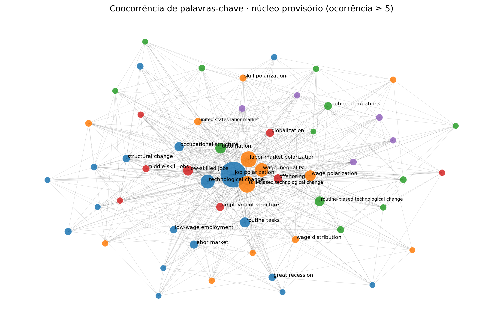
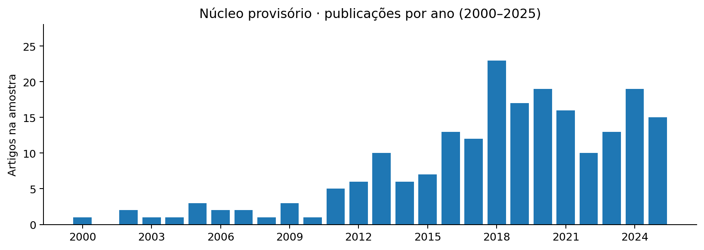
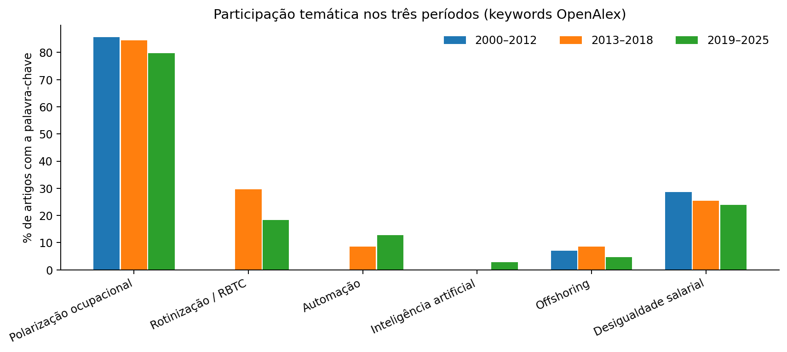
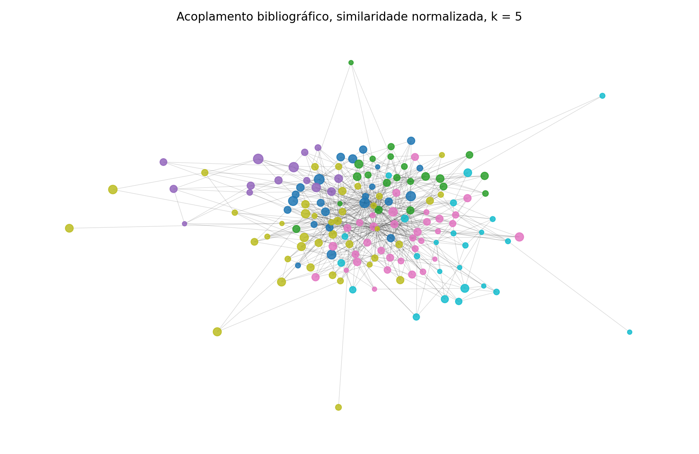
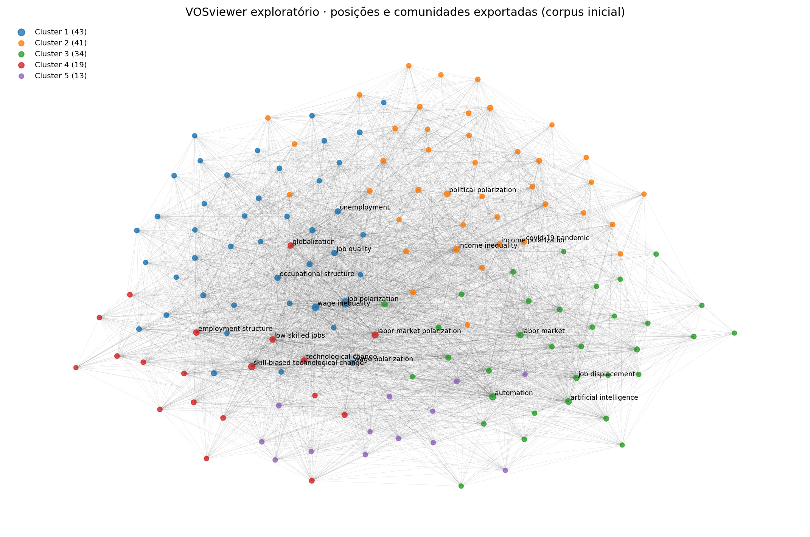

# Relatório preliminar de bibliometria — gerado automaticamente

> **Natureza:** análise exploratória com corpus de 208 trabalhos **provisoriamente** classificados.
> Este arquivo foi produzido por `scripts/08_gerar_relatorio.py` a partir das tabelas calculadas.
> Os dados originais não foram modificados e nenhum acesso à API foi necessário.

## 1. Fonte e seleção do corpus

- Consultas em OpenAlex, anos 2000–2025: **4975 aparições** em seis buscas.
- Deduplicação por OpenAlex ID: **3468 registros únicos**; aparições excedentes **1507**.
- Classificação por regras explícitas + rótulos históricos de amostra de 120 trabalhos: **208 núcleo provisório**, **845 revisão pendente**, **2415 não selecionados**.

As regras estão em `scripts/02_triagem.py`. **Amostra de 120 rotulada em trabalho preliminar**, não é certificação independente de qualidade nem revisão de texto integral.

## 2. Rede temática — coocorrência de keywords OpenAlex

- Termos com no mínimo 5 artigos: **56 nós**, **545 arestas**, força total **1171**.
- Comunidades Louvain: **5**; modularidade ponderada **0.1371**.
- Sensibilidade ao termo âncora `job polarization`: modularidade com âncora **0.1371**, sem âncora **0.1857**.

### Termos frequentes

| Termo | Ocorrências | Força da ligação |
| --- | ---: | ---: |
| job polarization | 125 | 339 |
| skill-biased technological change | 51 | 166 |
| labor market polarization | 48 | 118 |
| technological change | 36 | 127 |
| wage inequality | 34 | 105 |
| wage polarization | 21 | 67 |
| automation | 20 | 64 |
| low-skilled jobs | 18 | 73 |
| routine tasks | 18 | 76 |
| routine-biased technological change | 17 | 45 |
| occupational structure | 15 | 50 |
| offshoring | 13 | 57 |

**Rastrear arestas:** `rastreabilidade/03_arestas_keyword_com_documentos.csv`. Cada linha traz os OpenAlex IDs que originaram a ligação.

## 3. Evolução da amostra e indicadores temáticos

| Período | Artigos analisados | Com keyword automation | Percentual |
| --- | ---: | ---: | ---: |
| 2000–2012 | 28 | 0 | 0.0% |
| 2013–2018 | 71 | 6 | 8.5% |
| 2019–2025 | 109 | 14 | 12.8% |

Estes números dizem respeito às **keywords atribuídas pela OpenAlex** no corpus selecionado, não demonstram evolução da economia nem representam a totalidade da produção acadêmica.

## 4. Acoplamento bibliográfico

- Trabalhos com alguma referência indexada: **162**.
- Pares com duas ou mais referências compartilhadas: **8775**.
- Para visualizar a rede mais legível, selecionamos até 5 vizinhos por artigo, pelo coeficiente de Salton. Isso é um **filtro de visualização**, não um novo conjunto de artigos.

**Rastrear arestas:** `rastreabilidade/04_arestas_acoplamento_com_referencias.csv` exibe títulos, pesos e os IDs exatos das referências em comum.

## 5. Colaboração internacional e cobertura

- País de afiliação identificado em **165** dos 208 artigos.
- Artigos com autores afiliados em pelo menos dois países: **50**.
- Pares diferentes de países coafiliados: **54**.

**Rastrear relações:** `rastreabilidade/05_colaboracao_paises_com_artigos.csv`. O país é da **afiliação institucional**, não a nacionalidade do autor.

## 6. Primeira rede exportada do VOSviewer — somente comparação

- No mapa exploratório anterior, **150 termos**, **3524 arestas**, **5 clusters**.
- Modularidade desses clusters, recalculada sobre arestas exportadas: **0.1631**.

**Atenção:** esta rede decorre da **primeira busca exploratória**, anterior ao corpus de 3.468/208. Não confundir com a rede de palavras-chave produzida em Python sobre 208 artigos.

## 7. Limitações que devem ser apresentadas

- A base de 208 não foi validada integralmente e não deve ser chamada de amostra final.
- Há 845 trabalhos com elegibilidade pendente e possíveis publicações duplicadas sob IDs diferentes.
- O OpenAlex indexa palavras-chave automaticamente; coocorrências podem refletir a indexação.
- Algumas referências citadas não foram recuperadas como artigos-fonte, então seu nome aparece apenas pelo ID OpenAlex.
- A busca original quase não cobre IA recente e não foi desenhada para captar a transição verde/digital; requer busca adicional justificada antes de conclusões sobre esses eixos.
- Redes exploratórias são descritivas; não permitem inferir causalidade de IA sobre empregos ou salários.

## 8. Como reproduzir

Abra esta pasta no VS Code. No terminal, instale `pip install -r requirements.txt` e rode `python executar_tudo.py`. O script confere os hashes originais, refaz a triagem, redes, tabelas, figuras e testa as principais identidades.

**Fonte da coleta:** veja `dados/originais_openalex/02_auditoria_buscas.csv` e `codigo_historico/01_coleta_original_openalex.py`. **Reexecução sem API:** garantida pelo JSON congelado, para não depender de mudanças futuras na indexação OpenAlex.
